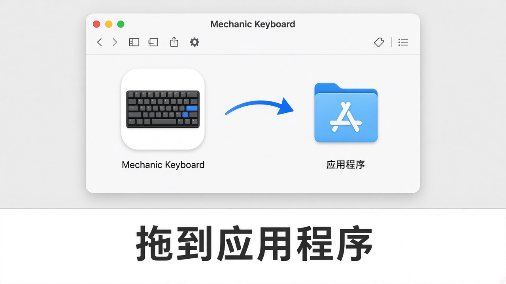
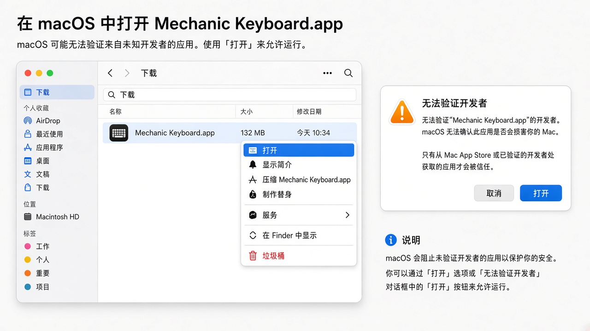
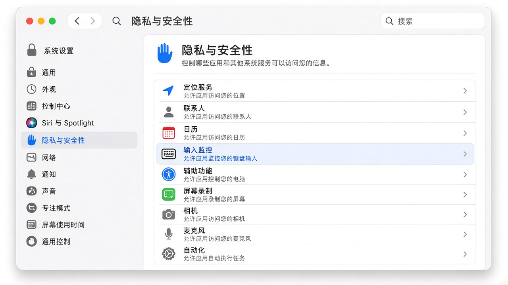
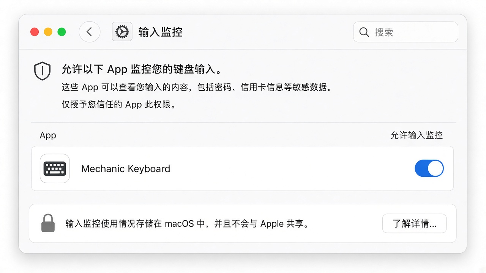
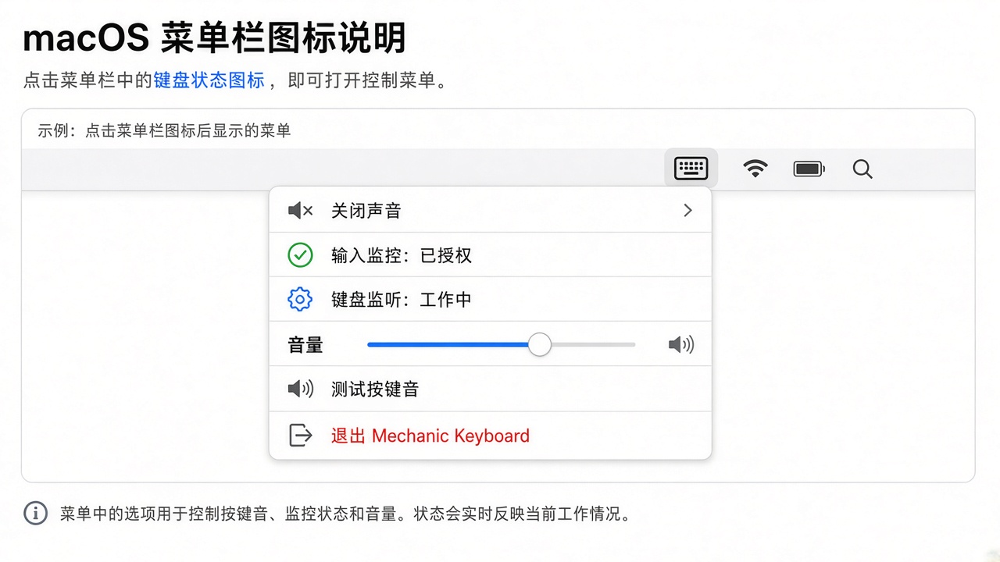

# Mechanic Keyboard

一款 macOS 菜单栏小工具：用笔记本电脑打字时，实时播放清脆的机械键盘按键音效，带来“输入快感”。

它**只监听按键事件来播放本地音效**，不会记录、保存或上传你敲了什么字。

---

## 使用说明（User Guide）

### 需要什么权限？

| 权限 | 中文名称 | 是否必须 | 用途 |
|------|----------|----------|------|
| Input Monitoring | **输入监控** | 必须 | 在后台监听全局按键事件，才能播放按键音 |

> 说明：系统设置里这项叫「输入监控（Input Monitoring）」，不是「辅助功能（Accessibility）」。  
> 若菜单栏图标发橙或显示未授权，按下面步骤打开即可。

---

### 1. 安装

1. 打开 `MechanicKeyboard-*.dmg`
2. 把 **Mechanic Keyboard** 拖到右边的 **Applications（应用程序）**



3. 到「应用程序」里找到 **Mechanic Keyboard**，双击打开

---

### 2. 第一次打不开？（Gatekeeper）

未公证的测试包，首次双击可能提示「无法验证开发者」。按下面做一次即可：

1. 在 **应用程序** 里选中 `Mechanic Keyboard`
2. **右键（或双指点按）→ 打开**
3. 在弹窗里再点一次 **打开**



之后正常双击就能启动。

---

### 3. 授予「输入监控」权限（最重要）

没有这项权限，App 听不到按键，也就不会出声。

#### 方法 A：从 App 菜单跳转（推荐）

1. 看屏幕右上角菜单栏，找到键盘图标 `⌨︎`
2. 点一下，选择 **Grant Input Monitoring...**
3. 系统会自动打开「隐私与安全性 → 输入监控」页面
4. 按下面「方法 B」把开关打开

#### 方法 B：手动打开系统设置

1. 打开 **系统设置（System Settings）**
2. 进入 **隐私与安全性（Privacy & Security）**
3. 在列表里找到并点开 **输入监控（Input Monitoring）**



4. 在列表中找到 **Mechanic Keyboard**，把右侧开关打开（如有锁图标，先点锁并输入密码）
5. 若列表里没有它：先启动一次 App，或点列表下方 **＋** 从「应用程序」里添加



6. 打开权限后，如未自动生效，可点菜单栏 **Quit Mechanic Keyboard** 重新打开一次

---

### 4. 确认已经生效

点菜单栏 `⌨︎` 图标，正常状态如下：

- **Input Monitoring: Granted**（输入监控：已授权）
- **Keyboard Monitor: Active**（键盘监听：工作中）
- 菜单栏图标不再显示橙色警告色



然后：

1. 点菜单里的 **Test Click**，应能听到一声点击
2. 在任意 App 里正常打字，每次按下（非长按连发）都会有按键音
3. 可用菜单里的 **Volume** 滑杆调节音量；不需要时选 **Disable Sound**

---

### 5. 菜单功能一览

| 菜单项 | 作用 |
|--------|------|
| `Enable Sound` / `Disable Sound` | 开启 / 关闭按键音 |
| `Input Monitoring: ...` | 查看或跳转授予「输入监控」权限 |
| `Keyboard Monitor: ...` | 查看键盘事件监听状态（点击可刷新） |
| `Volume` | 调节按键音音量 |
| `Choose Sound Files...` | 选择自定义音频文件（支持多选，按键时随机播放） |
| `Use Built-in Sound` | 恢复默认内置机械键盘音效 |
| `Test Click` | 试听一声按键音 |
| `Quit Mechanic Keyboard` | 退出应用 |

---

### 6. 常见问题（FAQ）

- **完全没有声音？**
  1. 确认菜单第一项不是 `Enable Sound`（若是，点一下开启声音）
  2. 确认 `Volume` 滑杆不是 0，系统输出设备没有静音
  3. 确认「输入监控」已开启，且菜单显示 `Keyboard Monitor: Active`
  4. 退出 App 重开一次；仍无声可在「输入监控」里将开关关掉再打开
- **菜单栏图标是橙色？**
  - 表示键盘监听尚未就绪（通常是「输入监控」权限未授予）。按上面第 3 步开启权限即可。
- **使用蓝牙耳机感觉有延迟？**
  - App 内部音频缓冲已优化到约 5ms（128 frames @ 硬件采样率）；若仍感延迟，通常来自蓝牙耳机本身的无线传输延迟（约 100~200ms）。

---

## 本地构建与打包（Build & Package）

### 编译 `.app`

```sh
./build_app.sh
```

生成的应用程序位于 `./MechanicKeyboard.app`，可直接拷贝至 `/Applications` 运行：

```sh
cp -R MechanicKeyboard.app /Applications/
open /Applications/MechanicKeyboard.app
```

### 打包 `.dmg` 安装镜像

```sh
./package_dmg.sh
```

会在项目根目录生成带 `Applications` 拖拽快捷方式的 `MechanicKeyboard-0.3.0.dmg`。

---

## Mac App Store 归档

仓库包含用于 App Store 归档的 Xcode 工程：

```sh
open MechanicKeyboard.xcodeproj
```

命令行归档与导出：

```sh
DEVELOPMENT_TEAM=ABCDE12345 ./scripts/archive_app_store.sh
DEVELOPMENT_TEAM=ABCDE12345 ./scripts/archive_app_store.sh --export
```
