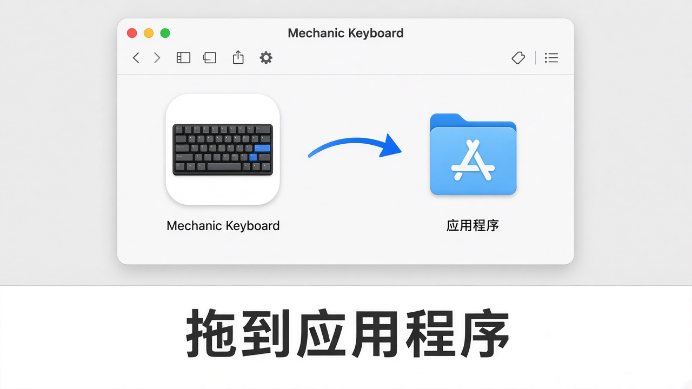
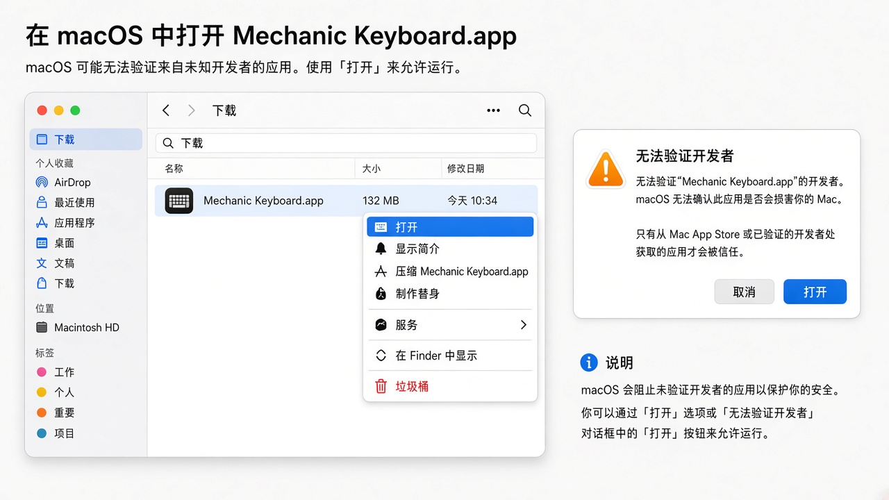
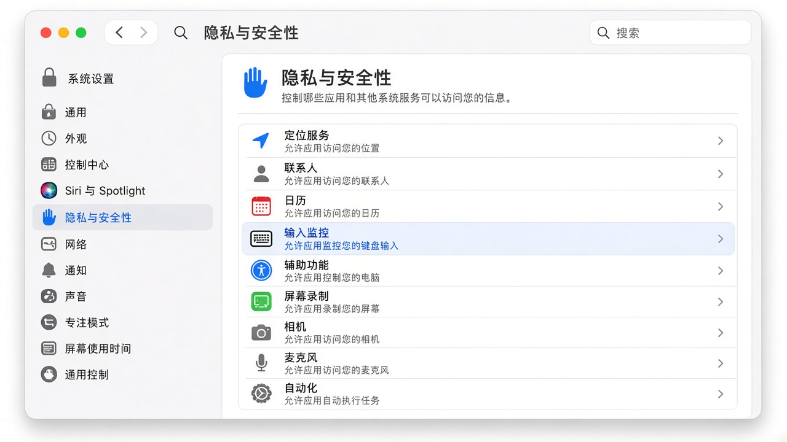
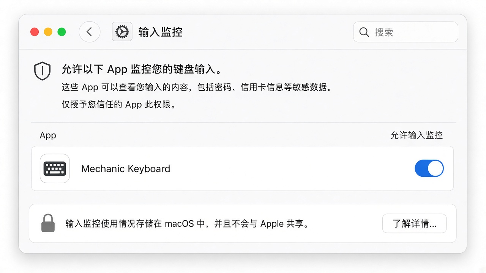
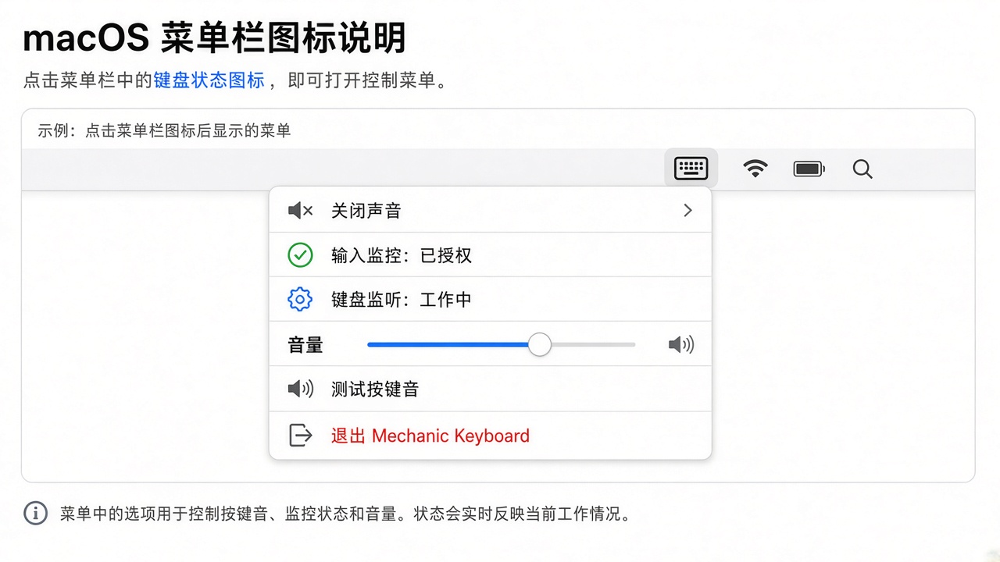

# Mechanic Keyboard 使用说明

Mechanic Keyboard 是一款 macOS 菜单栏小工具：你打字时，它会播放机械键盘风格的按键音。

它**只监听按键事件来播放本地音效**，不会记录、保存或上传你敲了什么字。

---

## 需要什么权限？

| 权限 | 中文名称 | 是否必须 | 用途 |
|------|----------|----------|------|
| Input Monitoring | **输入监控** | 必须 | 在后台听到全局按键，才能播放按键音 |

> 说明：系统设置里这项叫「输入监控」，不是「辅助功能 / Accessibility」。  
> 若菜单里显示「输入监控：未授权」或图标发橙，按下面步骤打开即可。

---

## 1. 安装

1. 打开朋友发来的 `MechanicKeyboard-*.dmg`
2. 把 **Mechanic Keyboard** 拖到右边的 **Applications（应用程序）**

3. 到「应用程序」里找到 **Mechanic Keyboard**，双击打开

---

## 2. 第一次打不开？（Gatekeeper）

未公证的测试包，双击可能提示「无法验证开发者」。按下面做一次即可：

1. 在 **应用程序** 里选中 `Mechanic Keyboard`
2. **右键（或双指点按）→ 打开**
3. 在弹窗里再点一次 **打开**

之后正常双击就能启动。

---

## 3. 授予「输入监控」权限（最重要）

没有这项权限，App 听不到按键，也就不会出声。

### 方法 A：从 App 菜单跳转（推荐）

1. 看屏幕右上角菜单栏，找到键盘图标 ⌨︎  
2. 点一下，选择 **Grant Input Monitoring...**  
3. 系统会打开「隐私与安全性」相关页面  
4. 按下面「方法 B」把开关打开

### 方法 B：手动打开系统设置

1. 打开 **系统设置（System Settings）**
2. 进入 **隐私与安全性（Privacy & Security）**
3. 在列表里找到并点开 **输入监控（Input Monitoring）**

4. 在列表中找到 **Mechanic Keyboard**
5. 把右侧开关打开（如有锁图标，先点锁并输入密码）
6. 若列表里没有它：先启动一次 App，或点列表下方 **＋** 从「应用程序」里添加

7. 打开权限后，**退出并重新打开** Mechanic Keyboard（菜单 → Quit）

---

## 4. 确认已经生效

点菜单栏 ⌨︎ 图标，理想状态类似：

- **Input Monitoring: Granted**（输入监控：已授权）
- **Keyboard Monitor: Active**（键盘监听：工作中）
- 图标不再显示橙色警告色

然后：

1. 点菜单里的 **Test Click**，应能听到一声点击  
2. 在任意 App 里正常打字，每次按下（非长按连发）都会有按键音  
3. 可用菜单里的 **Volume** 滑杆调节大小；不需要时选 **Disable Sound**

---

## 5. 常用功能

| 菜单项 | 作用 |
|--------|------|
| Enable Sound / Disable Sound | 开/关按键音 |
| Volume | 调节音量 |
| Choose Sound Files... | 选择自定义音频（可多选，随机播放） |
| Use Built-in Sound | 恢复内置音效 |
| Test Click | 试听一声 |
| Quit Mechanic Keyboard | 退出 |

---

## 6. 常见问题

### 完全没有声音？

1. 确认菜单不是 **Disable Sound**
2. 确认音量滑杆不是 0，系统输出设备没静音  
3. 确认 **输入监控** 已打开，且菜单显示 **Keyboard Monitor: Active**  
4. 关掉 App 再开一次；仍不行就在「输入监控」里关掉再打开该开关  

### 图标是橙色？

表示键盘监听未就绪（多半是权限未给，或刚给权限后还没恢复）。按第 3 步检查「输入监控」，然后重启 App。

### 换电脑 / 重装后要重新授权吗？

要。换机器、删掉重装，或从「应用程序」换到别的路径再运行，系统常会要求重新打开「输入监控」。

### 支持 Intel Mac 吗？

当前测试包为 **Apple Silicon（arm64）**。Intel Mac 需要单独的 Intel/通用架构包。

### 会不会上传我的键盘内容？

不会。权限只用于本地播放音效；不记录、不存储、不上传按键内容。

---

## 7. 快速检查清单

- [ ] 已拖到「应用程序」
- [ ] 首次如被拦截，已用「右键 → 打开」
- [ ] 「输入监控」里 Mechanic Keyboard 已打开
- [ ] 菜单显示监听 Active，Test Click 有声音
- [ ] 打字时有按键音

有问题把菜单里这几项的状态（输入监控 / 键盘监听）截图发给对方即可排查。
